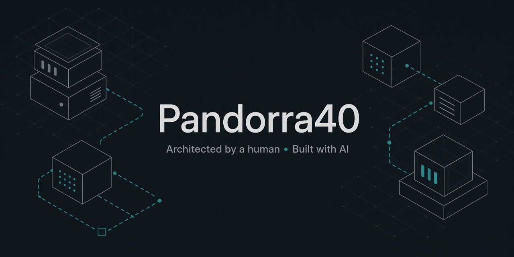

  

### Projets open source · vibe-coding · logiciels libres utiles

**Je conçois et oriente sur mon temps libre. L’IA code. Self-hosting · Nuxt · Docker · sécurité**

---

## Français

Salut — je ne me présente **pas** comme développeur pro. Sur mon temps libre, en **bénévolat / hobby**, je **conçois et oriente** des projets utiles : besoin, contraintes, stack, sécurité, hébergement… et je fais construire par des **agents IA** (vibe-coding).

Le résultat : des outils **ouverts, sobres et utiles**, souvent hébergés chez moi (VPS, NAS, reverse-proxy, CrowdSec…). L’idée, ce n’est pas « écrire chaque ligne à la main », c’est **livrer quelque chose qui tourne**, qu’on peut auditer, et qui reste maintenable.

### Projets

* **[Annuaire TSA](https://github.com/Pandorra40/annuaire-tsa)** : annuaire collaboratif et gratuit de praticiens spécialisés dans les troubles du spectre autistique.  
  → Site : [annuaire-tsa.fr](https://www.annuaire-tsa.fr)

* **[Hébernet](https://github.com/Pandorra40/hebernet)** : Panneau d’hébergement open source (bêta) : sites web, runtimes et services, sur Docker. 

### Ce qui m’intéresse

* Concevoir des apps web modernes (Nuxt, API, SEO, accessibilité) **avec l’IA comme main-d’œuvre**
* Self-hosting et reverse-proxy (NPMplus, CrowdSec, supervision)
* Sécurité pratique : Dependabot, Code scanning, durcissement, moindre privilège
* Logiciel libre au service de besoins concrets (santé, familles, admin sys)

---

## English

Hi — I don’t present myself as a professional **developer**. In my free time, as a **volunteer / hobbyist**, I **design and steer** useful projects: needs, constraints, stack, security, hosting… and I have **AI agents** build them (vibe-coding).

The outcome: **open, lean, useful** tools, often self-hosted (VPS, NAS, reverse-proxy, CrowdSec…). The point isn’t “hand-writing every line”: it’s **shipping something that runs**, can be audited, and stays maintainable.

### Projects

* **[Annuaire TSA](https://github.com/Pandorra40/annuaire-tsa)** : free collaborative directory of practitioners specialised in autism spectrum conditions.  
  → Live site: [annuaire-tsa.fr](https://www.annuaire-tsa.fr)

* **[Hébernet](https://github.com/Pandorra40/hebernet)** : Open-source hosting platform (beta): websites, runtimes, and services on Docker.

### Interests

* Designing modern web apps (Nuxt, APIs, SEO, accessibility) **with AI as the workforce**
* Self-hosting and edge security (reverse-proxy, CrowdSec, supervision)
* Practical AppSec: Dependabot, Code scanning, hardening, least privilege
* Free software for real-world needs (health, families, sysadmin)

---

*Architected by a human. Built with AI. Open and useful.*

